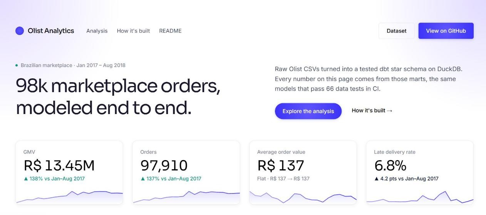
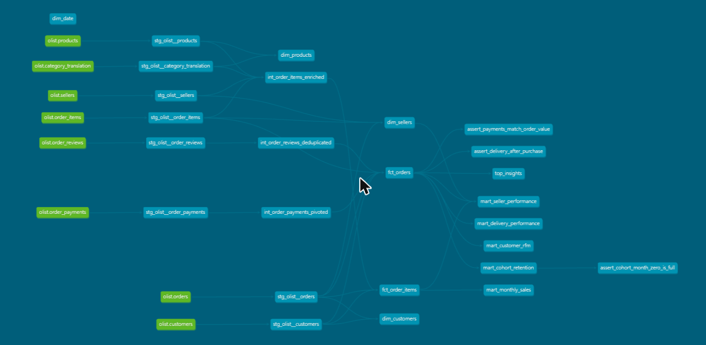
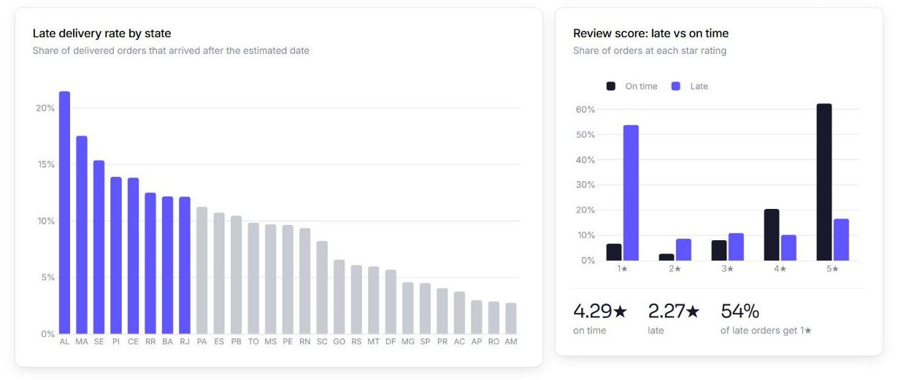

# E-commerce Analytics with dbt + DuckDB


An end-to-end analytics engineering project on the **Olist Brazilian E-commerce** dataset (about 100k orders, 2016–2018).
Raw CSVs are modeled with **dbt** on **DuckDB** into a tested star schema and business-ready marts, then served in a **Streamlit** dashboard.

### 👉 [Live dashboard](https://dhia-sa-ecommerce-analytics.streamlit.app/)

<sub>Hosted free on Streamlit Community Cloud. If it has been idle, the first load takes about 30 seconds to wake up.</sub>



**At a glance:** 22 dbt models · 66 data tests (all passing) · full build in about 10 seconds on a laptop · no cloud warehouse needed.

## Architecture

```
Kaggle CSVs ──► DuckDB (read_csv) ──► dbt
                                      ├── staging        8 views   · rename, cast, 1:1 with source
                                      ├── intermediate   3 views   · dedupe, pivot, enrich
                                      └── marts
                                          ├── core       star schema: fct_orders, fct_order_items,
                                          │              dim_customers, dim_products, dim_sellers, dim_date
                                          └── analytics  monthly sales, delivery, RFM, cohorts, sellers
                                                              │
                                                              ▼
                                                      Streamlit dashboard
```

### Lineage (from `dbt docs`)



## Data model

| Layer | Model | Grain |
|---|---|---|
| Core | `fct_orders` | one row per order: value, payment, delivery, review |
| Core | `fct_order_items` | one row per order item |
| Core | `dim_customers` | one row per real customer (`customer_unique_id`) |
| Core | `dim_products` / `dim_sellers` / `dim_date` | one row per product / seller / day |
| Analytics | `mart_monthly_sales` | month × product category |
| Analytics | `mart_delivery_performance` | month × customer state |
| Analytics | `mart_customer_rfm` | customer, with RFM scores and segment |
| Analytics | `mart_cohort_retention` | cohort month × months since first order |
| Analytics | `mart_seller_performance` | seller |

### Data quality decisions

- **Customers:** Olist creates a new `customer_id` for every order, so all customer analysis uses `customer_unique_id`.
- **Reviews:** some orders have several reviews and some reviews are linked to several orders. `int_order_reviews_deduplicated` keeps exactly one review per order (the most recently answered).
- **Types:** every raw column is read as `VARCHAR` and cast in staging, so zip codes keep their leading zeros.
- **Categories:** two categories have no English translation and about 600 products have no category. These fall back to the Portuguese name or `unknown`.
- **Analysis window:** the data is sparse before 2017 and after August 2018. The analytics marts use the `analysis_start_date` / `analysis_end_date` vars (2017-01 → 2018-08).
- **Tests:** 66 data tests cover keys, relationships, accepted values and ranges, plus singular tests. Payment vs. order value mismatches (vouchers, interest) are a **warning**, not a failure.

## Key insights (Jan 2017 – Aug 2018)

- **GMV R$ 13.4M** (product value, excluding freight) across about 98k valid orders. Average order value is **R$ 137**.
- **Late delivery destroys satisfaction:** late orders average **2.3★**, against **4.3★** for on-time orders. About 7% of delivered orders arrive late. Among the larger states the rate is highest in CE, BA and RJ (12–14%); some small northeastern states such as AL and MA reach 17–21%.


- **Almost no repeat business:** only about **3%** of customers ever order twice, and month-1 cohort retention is under **0.5%**. Growth comes from acquisition, so retention is the biggest opportunity.
- **Top categories by GMV:** health & beauty, watches & gifts, bed/bath/table, sports & leisure, computers & accessories.

## How to run

Requires Python 3.10–3.13 (dbt does not support 3.14 yet).

```bash
# 1. Clone and create a virtual environment
git clone https://github.com/dhia-sa/ecommerce-analytics-dbt.git
cd ecommerce-analytics-dbt
python -m venv .venv
.venv\Scripts\activate            # macOS/Linux: source .venv/bin/activate
pip install -r requirements.txt

# 2. Get the data: copy the Kaggle CSVs into data/raw/
#    or download them with the Kaggle API (needs ~/.kaggle/kaggle.json)
python scripts/download_data.py

# 3. Build everything (models and tests)
dbt deps
dbt build

# 4. Explore
dbt docs generate && dbt docs serve     # lineage graph and documentation
streamlit run dashboard/app.py          # dashboard
```

> **Tip:** to use CSVs that are already somewhere else without copying them, override the path:
> `dbt build --vars "{raw_data_path: 'C:/Users/you/Downloads/archive'}"`

## Hosted dashboard

The live app runs on Streamlit Community Cloud straight from this repo (`dashboard/app.py`).
The cloud has no raw data, so the app reads a 4.5 MB snapshot of the six tables it needs, `dashboard/data/dashboard.duckdb`. Locally, it prefers the full `ecommerce.duckdb` when that file exists.
After changing the models, refresh the snapshot and push:

```bash
dbt build
python scripts/export_dashboard_db.py
git add dashboard/data/dashboard.duckdb && git commit -m "Refresh dashboard snapshot" && git push
```

`dashboard/requirements.txt` pins `duckdb` to the version that wrote the snapshot. Upgrade both together.

## CI

GitHub Actions (`.github/workflows/dbt_build.yml`) runs on every push and pull request. It installs the dbt packages, lints the SQL with sqlfluff and compiles every model.
If `KAGGLE_USERNAME` and `KAGGLE_KEY` are set as repository secrets, it also downloads the data, runs the full `dbt build` (models and tests) and uploads the dbt docs as an artifact.

## Project structure

```
├── .github/workflows/dbt_build.yml
├── analyses/                 ad-hoc SQL
├── dashboard/
│   ├── app.py                Streamlit app
│   ├── data/dashboard.duckdb snapshot for the hosted app
│   └── requirements.txt      hosted-app dependencies (pinned)
├── data/raw/                 Olist CSVs (gitignored)
├── macros/                   generate_schema_name override
├── models/
│   ├── staging/              stg_olist__*  + sources
│   ├── intermediate/         int_*
│   └── marts/
│       ├── core/             fct_*, dim_*
│       └── analytics/        mart_*
├── scripts/download_data.py
├── tests/                    singular data tests
├── dbt_project.yml
├── packages.yml
└── profiles.yml              DuckDB file: ecommerce.duckdb
```

## Tech stack

dbt-core · dbt-duckdb · DuckDB · dbt_utils · sqlfluff · Streamlit · Plotly · GitHub Actions
